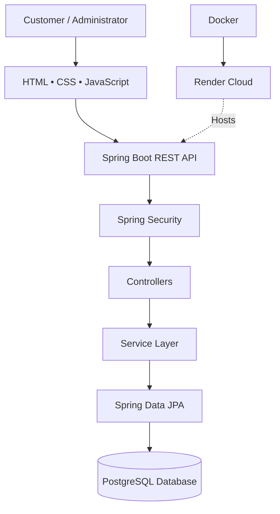
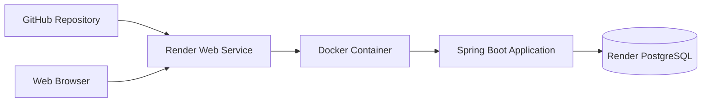

<div align="center">

# 🛍️ NEXORA
### E-Commerce Management System

**A modern full-stack e-commerce platform built with Java, Spring Boot, and PostgreSQL.**

*Discover products. Shop effortlessly. Manage everything.*

[](https://www.java.com/)
[](https://spring.io/projects/spring-boot)
[](https://www.postgresql.org/)
[](https://www.docker.com/)
[](https://render.com/)

<br>

### 🌐 LIVE APPLICATION

**[🚀 VISIT NEXORA SHOP](https://nexora-shop-x6xa.onrender.com)**

[Live Website](https://nexora-shop-x6xa.onrender.com) · [Source Code](https://github.com/Zhasulan-1/EcommerceManagementSystem)

</div>

---

## ✨ Overview

**NEXORA** is a full-stack e-commerce application designed to deliver a modern online shopping experience while providing administrators with powerful tools for store management.

The project combines a responsive web interface with a Java-based backend, secure authentication, relational data storage, and a RESTful API.

It demonstrates practical software engineering concepts including:

- Full-stack web application development
- REST API design and integration
- Authentication and role-based authorization
- Relational database modeling
- Shopping cart and order processing
- Design patterns and layered architecture
- Containerization and cloud deployment

---

## 🚀 Features

### 🛒 Customer Experience

| Feature | Description |
|:---|:---|
| 🔐 Authentication | User registration and secure login |
| 👤 Personal Account | View and manage account information |
| 🛍️ Product Catalog | Browse available products |
| 🔎 Search & Filters | Find products by search criteria |
| 📂 Categories | Explore products by category |
| 🛒 Shopping Cart | Add, update, and remove products |
| 📦 Checkout | Create orders with delivery information |
| 💳 Demo Payments | Simulate payment operations |
| 🏷️ Promotions | Apply supported promotional discounts |
| 🚚 Order Tracking | Review order history and order status |
| 🔔 Notifications | View account and order notifications |

### 🛠️ Administration Dashboard

NEXORA includes a dedicated administration interface for managing store operations.

| Module | Capabilities |
|:---|:---|
| 📊 Dashboard | View store statistics and operational metrics |
| 📦 Products | Manage products, prices, and inventory |
| 📁 Categories | Create and manage product categories |
| 🧾 Orders | Review orders and update their statuses |
| 🎟️ Promotions | Create, update, and manage discount codes |
| 🔔 Notifications | Manage notifications |
| 👥 Customers | Monitor customer-related statistics |

### 🔑 Role-Based Access

The application supports two primary roles:

**CUSTOMER**
- Browse products
- Manage a shopping cart
- Create orders
- Complete simulated payments
- Review personal order history

**ADMIN**
- Access the administration dashboard
- Manage store inventory and categories
- Manage orders and promotions
- View administrative statistics
- Perform authorized management operations

Access to protected backend endpoints is controlled through Spring Security.

---

## 🧰 Technology Stack

### Backend

| Technology | Purpose |
|:---|:---|
| Java 21 | Main programming language |
| Spring Boot | Backend application framework |
| Spring Web | REST API development |
| Spring Security | Authentication and authorization |
| Spring Data JPA | Persistence and database access |
| Hibernate | Object-relational mapping |
| Maven | Dependency management and build automation |

### Frontend

| Technology | Purpose |
|:---|:---|
| HTML5 | Application structure |
| CSS3 | Styling and responsive layouts |
| JavaScript | Client-side functionality |
| Fetch API | Communication with backend services |

### Database & Deployment

| Technology | Purpose |
|:---|:---|
| PostgreSQL | Relational database |
| Docker | Application containerization |
| Render | Cloud hosting |
| Git & GitHub | Version control and source management |

---

## 🏗️ System Architecture

NEXORA follows a layered application architecture.



### Architecture Layers

**Presentation Layer**

Provides the customer storefront and administration dashboard.

**Controller Layer**

Exposes REST endpoints and receives HTTP requests.

**Service Layer**

Contains the application's business logic, including cart management, checkout, order processing, and promotions.

**Repository Layer**

Handles persistence operations using Spring Data JPA.

**Database Layer**

Stores users, products, categories, carts, orders, payments, promotions, and related application data.

---

## 📁 Project Structure

```text
EcommerceManagementSystem/
│
├── .mvn/
├── database/
├── docs/
│
├── src/
│   ├── main/
│   │   ├── java/
│   │   │   └── com/example/ecommercemanagementsystem/
│   │   │       ├── config/
│   │   │       ├── controller/
│   │   │       ├── decorator/
│   │   │       ├── dto/
│   │   │       ├── entity/
│   │   │       ├── enums/
│   │   │       ├── exception/
│   │   │       ├── repository/
│   │   │       ├── service/
│   │   │       ├── strategy/
│   │   │       └── EcommerceManagementSystemApplication.java
│   │   │
│   │   └── resources/
│   │       ├── static/
│   │       │   ├── admin/
│   │       │   ├── css/
│   │       │   ├── js/
│   │       │   ├── pages/
│   │       │   └── index.html
│   │       └── application.properties
│   │
│   └── test/
│
├── Dockerfile
├── pom.xml
├── mvnw
├── mvnw.cmd
└── README.md
```

---

## 🔗 REST API Overview

The backend provides RESTful endpoints for the main application modules.

| Module | Base Endpoint |
|:---|:---|
| Authentication | `/api/auth` |
| Products | `/api/products` |
| Categories | `/api/categories` |
| Cart | `/api/cart` |
| Orders | `/api/orders` |
| Payments | `/api/payments` |
| Promotions | `/api/promotions` |
| Notifications | `/api/notifications` |
| Administration | `/api/admin` |

### Example Endpoints

| Method | Endpoint | Description |
|:---|:---|:---|
| POST | `/api/auth/register` | Register a customer |
| POST | `/api/auth/login` | Log in |
| GET | `/api/auth/me` | Retrieve the current user |
| GET | `/api/cart` | Retrieve the current cart |
| POST | `/api/cart/items` | Add a product to the cart |
| POST | `/api/orders/checkout` | Create an order |
| GET | `/api/orders/my` | Retrieve personal orders |
| GET | `/api/notifications/admin` | Retrieve admin notifications |
| GET | `/api/admin/dashboard` | Retrieve dashboard statistics |

Some endpoints require authentication or administrator privileges.

---

## 💳 Demo Payment System

NEXORA includes a payment simulation feature for demonstrating the checkout process without processing real financial transactions.

### Available Payment Methods

- Bank Card — simulated payment
- Kaspi — simulated payment
- PayPal — simulated payment

### Payment Workflow

```text
Browse Products
       ↓
Add to Cart
       ↓
Review Cart
       ↓
Checkout
       ↓
Enter Delivery Information
       ↓
Apply Promotion (Optional)
       ↓
Create Order
       ↓
Select Payment Method
       ↓
Simulate Payment
       ↓
View Order History
```

> **Important:** Payments are simulated for educational and demonstration purposes. No real money is transferred.

---

## ⚙️ Getting Started

Follow these steps to run NEXORA locally.

### 1. Prerequisites

Make sure the following tools are installed:

- Java Development Kit 21
- PostgreSQL
- Git
- IntelliJ IDEA or another Java IDE

The project includes the Maven Wrapper.

### 2. Clone the Repository

```bash
git clone https://github.com/Zhasulan-1/EcommerceManagementSystem.git
cd EcommerceManagementSystem
```

### 3. Prepare PostgreSQL

Create a local PostgreSQL database:

```sql
CREATE DATABASE ecommerce_db;
```

### 4. Configure Environment Variables

The application uses the following environment variables:

| Variable | Description |
|:---|:---|
| `DB_URL` | PostgreSQL JDBC connection URL |
| `DB_USERNAME` | PostgreSQL username |
| `DB_PASSWORD` | PostgreSQL password |
| `PORT` | HTTP server port (optional, default 8080) |

Example local configuration:

```bash
export DB_URL="jdbc:postgresql://localhost:5432/ecommerce_db"
export DB_USERNAME="your_database_username"
export DB_PASSWORD="your_database_password"
```

Configure the same values in your IDE run configuration if starting the application directly from IntelliJ IDEA.

### 5. Run the Application

On macOS or Linux:

```bash
./mvnw spring-boot:run
```

On Windows:

```powershell
.\mvnw.cmd spring-boot:run
```

### 6. Open the Application

Once the server has started, open:

**http://localhost:8080**

The application uses Spring Data JPA and Hibernate for database persistence.

---

## ☁️ Cloud Deployment

NEXORA is deployed using **Render**, **Docker**, and **PostgreSQL**.

### Deployment Architecture



### Deployment Configuration

| Setting | Value |
|:---|:---|
| Hosting Platform | Render |
| Runtime | Docker |
| Application | Spring Boot |
| Java Version | 21 |
| Database | PostgreSQL |
| Deployment Branch | `main` |
| Application Port | Render-provided port |
| Environment | Production |

### Production Environment Variables

```text
DB_URL
DB_USERNAME
DB_PASSWORD
PORT
```

Database credentials are configured through Render environment variables and should not be committed to GitHub.

### Live Deployment

🌐 **https://nexora-shop-x6xa.onrender.com**

> The demonstration deployment uses cloud resources that may be subject to free-tier limitations or expiration. Demo data and service availability can change.

---

## 🔒 Security

The application uses Spring Security to protect authentication and administrative functionality.

Security measures include:

- Password hashing
- Session-based authentication
- Role-based access control
- Protected REST endpoints
- CSRF protection
- User-specific access restrictions
- Environment-based database credentials

**Security Reminder:** Never publish database passwords, connection secrets, or production credentials in the repository.

---

## 🎯 Project Objectives

This project was developed to apply software engineering principles to a practical e-commerce system.

The main objectives are:

1. Build a complete Java-based web application.
2. Design and implement a relational database.
3. Create and integrate REST APIs.
4. Implement secure authentication and authorization.
5. Develop customer and administrator interfaces.
6. Apply layered architecture and design patterns.
7. Deploy the application to a cloud platform.
8. Practice version control and collaborative development workflows.

---

## 🔮 Future Improvements

Potential future enhancements include:

- Integration with a real payment provider
- Product ratings and reviews
- Wishlist functionality
- Advanced analytics and reporting
- Email notification delivery
- Improved product image management
- Additional automated tests
- Performance optimization
- Enhanced mobile shopping experience

---

## 📌 Project Information

| Field | Details |
|:---|:---|
| Project Name | NEXORA |
| Project Type | Full-Stack E-Commerce Web Application |
| Backend | Java & Spring Boot |
| Frontend | HTML, CSS & JavaScript |
| Database | PostgreSQL |
| Deployment | Docker & Render |
| Repository | [EcommerceManagementSystem](https://github.com/Zhasulan-1/EcommerceManagementSystem) |
| Live Demo | [NEXORA Shop](https://nexora-shop-x6xa.onrender.com) |

---

<div align="center">

### NEXORA — Discover What's Next.

**Built with Java, Spring Boot, PostgreSQL, and a passion for software engineering.**

[🌐 Live Website](https://nexora-shop-x6xa.onrender.com) • [💻 GitHub Repository](https://github.com/Zhasulan-1/EcommerceManagementSystem)

---

⭐ **If you find this project interesting, consider giving it a star!**

</div>
